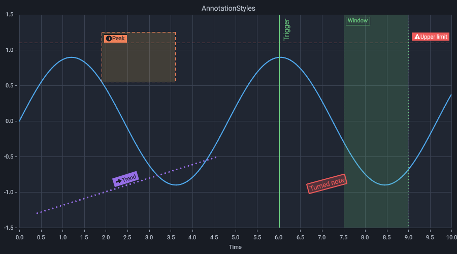

# Annotations

In XAML they live under `Chart.Annotations`:

```xml
<t:HorizontalLineAnnotation Y="1.5" />
<t:VerticalLineAnnotation X="3" />
<t:BoxAnnotation />
<t:TextAnnotation X="3" Y="1.5" Text="Start" />
<t:LineAnnotation X1="1" Y1="0" X2="8" Y2="2" />
```

`LineAnnotation` is a free line between two points at any angle. In code it is `new LineAnnotation(xAxis, yAxis)` with `SetEnds(x1, y1, x2, y2)` and an optional `Label` at the second end.

## Label and line style

Every annotation has an `Appearance` that sets how its label and its lines look. Left as it is, an annotation draws as it always did.

| Property | What it does |
|---|---|
| `LabelPlace` | Start, middle or end of the line; `Auto` keeps the usual place |
| `LabelSide`, `LabelOffset` | Which side of the line the label stands on, and a further distance from it |
| `LabelSize`, `LabelColor` | Size and color of the text |
| `LabelFill` | The plate behind the text; a transparent color leaves it out |
| `LabelBorder`, `LabelBorderThickness` | A frame around the plate |
| `LabelTurn`, `LabelAngle` | `Level`, `AlongLine` (upright at a vertical line, reading upward, or following a sloped line) or a free `Angle` in degrees |
| `LabelIcon`, `LabelIconColor` | A sign before the text: warning, information, arrow or marker, in the color of the text or its own |
| `Dash`, `Thickness` | Solid, dashed or dotted lines and their width; a band draws its edges only with a width |

```csharp
chart.AddOverlay(new VerticalLineAnnotation(x)
{
    X = 6,
    Label = "Trigger",
    Appearance = new AnnotationAppearance { LabelTurn = LabelTurn.AlongLine, LabelFill = new Rgba8(0, 0, 0, 0), Dash = LineDash.Dashed },
});
```

In XAML colors take the form `#RRGGBB` or `#AARRGGBB`:

```xml
<t:HorizontalLineAnnotation Y="1.1" Label="Upper limit">
    <t:HorizontalLineAnnotation.Appearance>
        <core:AnnotationAppearance LabelPlace="End" LabelIcon="Warning" LabelColor="#FFFFFF" Dash="Dashed" />
    </t:HorizontalLineAnnotation.Appearance>
</t:HorizontalLineAnnotation>
```

Here `core` is `clr-namespace:Tachyon.Charts.Core.Annotations;assembly=Tachyon.Charts.Core`. Bands and boxes take a `Label` too. The configurator offers all of these settings for each annotation; its list of signs shows each sign before its name.



## Editing by mouse

The positions are bindings like any other. With the `AnnotationEdit` block, annotations whose `IsEditable` is set can be edited by mouse, and the new values arrive in the binding:

| Where you drag | What changes |
|---|---|
| Inside, away from the handles | The whole annotation moves; a horizontal line only up and down, a vertical one only sideways |
| An edge of a band | That limit alone |
| An edge or a corner of a box | That edge, or the two edges of the corner |
| An end of a line or an arrow | That end alone, so place and direction change freely |

The handles show as small squares while the pointer is over the annotation. Each drag is one step of the history: Ctrl+Z takes it back, Ctrl+Y makes it again, in the same order as zoom and pan. Delete removes the annotation touched last. Annotations work in the units of the axes, also on instruments: on a spectrum analyzer a band edge moves in hertz and a line in dBm.

`Annotation.EditFinished` reports the end of a drag (and of an undo), for example to save the values; `Edited` reports every step while dragging.

Annotations also appear in every [export](export.md).
