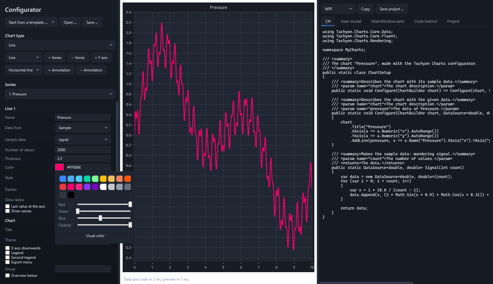

# Configurator

The configurator puts a chart together and writes its code. Settings are on the left, the chart in the middle and the generated C# on the right; every change shows at once in both. What the preview shows, the generated project shows: the same description builds both.

```bash
dotnet run --project src/Tachyon.Charts.Configurator.Wpf -c Release
dotnet run --project src/Tachyon.Charts.Configurator.Avalonia -c Release
dotnet run --project src/Tachyon.Charts.Configurator.Wpf -c Release -- --type medicalMpr
```

`--type` starts with a type, by its identifier (`line`, `spectrum`, `surface3d`, `medicalMpr` and so on); `--modifier` switches an interaction on (`crosshair`, `rollover`, `measure`, …).

Download the configurator from the release (WPF for Windows, Avalonia for Windows, Linux and macOS), install it as a tool, or run it from the repository:

```bash
dotnet tool install -g Tachyon.Charts.Configurator.Tool
tachyon-configurator --type spectrum --modifier crosshair
```

Every example of the showroom has its description in the configurator: the same data (the formulas of the examples are sample data of the configurator), colors, axes and interactions. Options that came with them: label rotation of category axes; base, floor and the handling of 0 and below of logarithmic axes; borders of markers and colors per point; the colormap of a density; extent, missing color and logarithmic colors of heatmaps; the range of the colors of a spectrogram; colors of stacked layers; gradients and shadow color of bars; collapsed groups of a Gantt chart; colors and hollow candles, the height of the volume, live prices and example drawings of candles; the number of spokes of a polar chart; the extent of contours; three more dash patterns and the intensity of a glow.

In the showroom, **Open in configurator** opens the example of the page completely: the same charts, including an overview below, series with their names and colors, axes, interactions, theme and data of the same form, live where the page is live (`--page <name>`). On pages that are checks rather than examples the button is greyed out; its tooltip says why. Medical pages start with the phantoms of the configurator, never with files loaded in the showroom. The showroom downloads carry the configurator beside them.


## Starting

- **Start from a template …** opens a ready description: a trend with limits, a spectrum with mask and marker, a spectrum with its live waterfall in 3D, an oscilloscope with four channels, a surface with height lines, a linked MPR with measuring tools, an analysis with profile and histogram.
- **Chart type** starts a new chart of one type with sample data.
- **Open …** and **Save …** read and write the description as `.chart.json`. A saved description opens again without loss. Paths of medical data are never saved; after opening, choose those files again.

## Series, axes and the chart

Every color field has a swatch beside its hex value. A click opens the color picker: a palette, sliders for red, green, blue and opacity, and **Usual color**, which leaves the field empty so that the chart takes the color of its theme. A color from the palette keeps the opacity chosen, so a band stays see-through. Typing `#RRGGBB` or `#RRGGBBAA` works as before.



- **+ Series** adds a series of the type chosen beside it; the list under *Series* chooses whose settings show. Types that fill a chart on their own, such as instruments, pies, 3D scenes and medical displays, stay alone.
- **+ Y axis** adds a value axis on the far side; each series picks its axis. Axes can show numbers, logarithms, time or categories, run through the origin, leave ranges out, hide, and stack in panes.
- **+ Annotation** adds a horizontal or vertical line, a band, a box, text or a free line. A new annotation starts where the chart shows, also on instruments in their units (dBm and hertz on a spectrum). In the preview every annotation moves with the mouse: drag it whole, drag an edge of a band or a box, or an end of a line. The new values go into the fields and the code at once, and Ctrl+Z in the preview takes a drag back. *Edit annotations by mouse* under *Interaction* gives the generated chart the same editing.
- *Chart* holds title, theme, X axis downwards, legends, the export menu of the generated window, a group for charts that share range and cursor, and **Overview below**: a small chart under the chart shows all data and the window of the chart; dragging the window moves it. The code gets a second chart and `ConfigureOverview`, joined through the group (`.Modifiers(m => m.Overview("Main"))`). *Interaction* switches zoom and pan, crosshair, tooltips and the other interactions.

## Data

*Data from* chooses the source of a series:

| Source | What it reads |
|---|---|
| Sample | Data made up for the type; the code contains the same method. |
| Csv | A CSV file: example files come with the configurator. Delimiter, header line and decimal comma are recognized, the columns are offered by name, several Y columns draw several lines. |
| Hdf5 | A dataset of an HDF5 file, chosen from a list: one dimension for curves and values, two for grids, three for volumes. |
| Live | A curve at a set rate into a first-in-first-out buffer, in the preview and in the code. |
| File | Points, volumes and models in 3D (XYZ, PLY, LAS, NIfTI, raw, STL, OBJ). |
| MedicalFile | A DICOM image, a DICOM series (any of its files stands for the folder), a NIfTI volume, with a NIfTI or DICOM SEG segmentation. |

Changes are worked on away from the window: the settings stay responsive while large data load, and the status line says how long data, code and preview took.

## 3D scenes

The scene of a 3D chart has the camera, a cut plane across an axis (**Cut at** is a value of that axis; what lies below it disappears, and a value outside the axis cuts through the middle) and the **range and title of each axis** of the box (`-25..25`); a range wins over the one the data set, and without a title of its own the axis keeps the title of the data. Without ranges of its own the box is set by the first series of the scene, and the series after it go into that box; choosing other data for a series of the scene clears the ranges and titles, so that the box fits the new data. The types bring further options: the **extent** of surfaces and columns, **height lines on the walls**, the **gloss** of columns, the **piece pulled out** of a pie, and bubbles sized in the units of the axes or in **screen points**. **Further planes** stand at any angle in box coordinates, where every axis spans -1 to 1: `-1 0 0 @ -0.35; -0.5 1 0 @ -0.5` gives the direction to the side that stays and the distance from the middle; `slice` after the distance makes a plane that only shows its cut. A surface can draw a **line at the limit** where it crosses its limit plane; columns take a **start** and a **base**; models take **gloss** and **sharpness** of their highlights, and models from samples or files keep the colors of their corners; **Color by** colors a model by its height or by the values its data bring (such as the temperature of the pipe bend) through the colormap, from the lowest to the highest value while **Colors follow the values** is on, or else from **Colors from** to **Colors to**; other data reset range and title, and values they do not bring become heights; the color scale beside the box shows the same colormap and range, so model and scale always agree. **Axis box only** shows the box with the axes of the scene and nothing in it. A **Volume** takes its colormap or the transfer function *Tissue and spots*, the slices through the middle and the share of values they leave out, where the surface of equal value lies, and its start and extent. A point cloud from the sample *landscape* loads when it is first drawn, with its progress, as large scans do. Sample data such as three clouds colored by height, the path of a particle, wells of three fields or a spiral of a million bubbles carry a color per point; the code takes them as they are. The samples *path of a particle, live* and *sweep of a surface* keep their points coming, 200 steps or 30 000 points every 30 ms, and the oldest fall out at the number of values; the code starts the same feed.

## Several charts

A description can hold several charts. **+ Chart** adds one with the type chosen beside it, **− Chart** removes the chosen one, and the list under **Charts** picks the chart whose fields show. Each chart has its own series, axes, annotations, legend and interactions; **Linked: zoom and crosshair** puts all charts into one group, so that zooming one moves the others and the crosshair shows in all; **Group** under *Chart* sets the group of a single chart, for two groups side by side. A chart that changes its type keeps its group and interactions, and a new chart joins the group of the first. **Columns** arranges them: the charts fill the rows from left to right.

The code gets one pair of files per chart, `ChartSetup.cs` and `ChartViewModel.cs` for the first, `Chart2Setup.cs` and `Chart2ViewModel.cs` for the second and so on, and a window with the charts in a grid:

```csharp
Chart.Configure(model.Configure);
Chart2.Configure(new Chart2ViewModel().Configure);
```

Linked views (medical planes, a waterfall beside its spectrum, a surface with its cut) and the overview below a chart belong to a single chart and stay without further charts.

## Instruments

The instrument types reproduce what the instrument pages of the showroom show:

| Type | Options |
|---|---|
| Oscilloscope | Channels with signal, volts per division and position; time base, trigger level, persistence. **Live acquisitions** at a rate, each at a random phase as from a free-running signal, with optional **noise**; the trigger holds the picture still. |
| Spectrum analyzer | Reference level, dB per division, max hold, density, limit mask with its **level above 3.2 MHz**, marker, axes. **Live spectra** at a rate; **history below the trace** as a second chart from the same measurement, or the history alone. Samples: three carriers, three carriers in noise, a drifting carrier. |
| Network analyzer | Level range, limit lines (the passing set, or **limits the filter fails**), a **second marker**. |
| Sweep monitor | Sweep or stepping, gap, names and **range per channel** (`-0.6..1.4, …`), **live samples** at a rate after the newest one. Samples: three channels, or a patient monitor with four channels at 25 000 samples per second. |

The generated code starts the same feeds with a timer it keeps in a field.

## Linked charts

Some types fill several charts from one display; a click, a window or a measurement in one shows in all.

- **Medical MPR (linked):** the volume in 3D at the upper left, then the axial, coronal and sagittal planes, as 2 × 2, a row or a column, with cine. The 3D chart takes a **title of its own**, such as the name of the data.
- **Medical analysis:** the volume in 3D, a plane with a line and a region, the profile along the line and the histogram of the region; each chart can be left out.
- **Medical oblique and curved:** 3D with the oblique plane in it, a plane, the oblique plane that follows its line and the curved section along its arc; each chart can be left out.
- **Spectrum with 3D waterfall:** a spectrum analyzer and its waterfall in 3D, side by side, one above the other, or the waterfall above the spectrum; reference level, divisions, mask and marker hold for both, and live spectra run into both. *Axes with numbers* labels frequency and level on the spectrum analyzer, alone or linked.
- **Surface with its cut:** a surface in 3D with a plane across it and, below, above or beside it, a chart of the height along the plane. Dragging the outline of the plane moves the curve; a click in 3D or a Ctrl+click on the curve sets a marker that shows in both. *Plane at* sets where it starts, from -1 to 1 across the box. The 3D chart keeps its own title and box.

The generated window arranges the charts in the same way, and the view model sets the shared data up once.


## Measuring in medical charts

Each medical image carries a bar of tools in its lower left corner: distance, angle, circle, rectangle, freehand and delete. A click chooses a tool, a click on the lit tool puts it away; then a drag moves points and the window again. The keys D, A, C, R and F do the same in the chart, Escape puts any tool away, Delete removes the selected measurement and Ctrl+Z brings it back. Measurements stay when settings change. In a linked display they show in 3D as well, on the slice they were drawn on.

## The code

The tabs on the right show the files of the project; **Copy** takes the open tab, **Save project …** writes a ZIP with a complete WPF or Avalonia project:

| File | Holds |
|---|---|
| `ChartSetup.cs` | The chart in the fluent API and the methods that make or read its data. |
| `ChartViewModel.cs` | The data as properties, ready for live updates from any thread. |
| `MainWindow.xaml` / `.axaml` and code behind | The window with the chart, or with the linked charts side by side. |
| Project file | The packages the chart needs, such as the 3D or the medical package. |

Medical code reads its files from the command line (`MedicalData`, `SegmentationData`), never from a path written into the code, and carries the note that the library is no medical device.

## Without the add-ons

Without the 3D or the medical package the configurator runs and leaves their types out.
