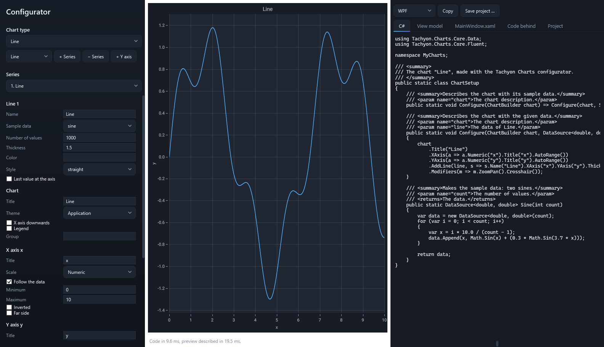
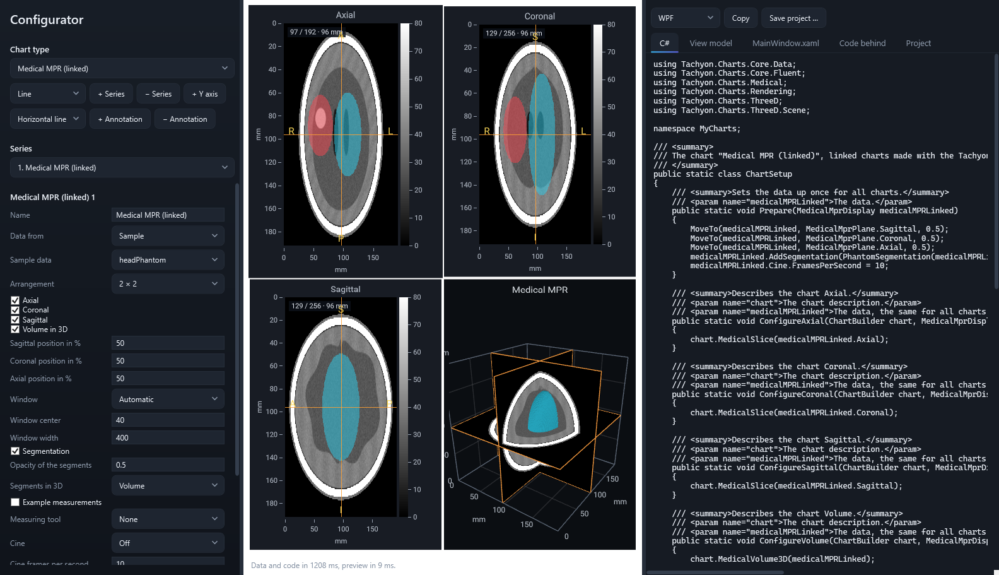

# Configurator

The configurator puts a chart together and writes its code. Settings are on the left, the chart in the middle and the generated C# on the right; every change shows at once in both. What the preview shows, the generated project shows: the same description builds both.

```bash
dotnet run --project src/Tachyon.Charts.Configurator.Wpf -c Release
dotnet run --project src/Tachyon.Charts.Configurator.Avalonia -c Release
dotnet run --project src/Tachyon.Charts.Configurator.Wpf -c Release -- --type medicalMpr
```

`--type` starts with a type, by its identifier (`line`, `spectrum`, `surface3d`, `medicalMpr` and so on).



## Starting

- **Start from a template …** opens a ready description: a trend with limits, a spectrum with mask and marker, a spectrum with its live waterfall in 3D, an oscilloscope with four channels, a surface with height lines, a linked MPR with measuring tools, an analysis with profile and histogram.
- **Chart type** starts a new chart of one type with sample data.
- **Open …** and **Save …** read and write the description as `.chart.json`. A saved description opens again without loss. Paths of medical data are never saved; after opening, choose those files again.

## Series, axes and the chart

- **+ Series** adds a series of the type chosen beside it; the list under *Series* chooses whose settings show. Types that fill a chart on their own, such as instruments, pies, 3D scenes and medical displays, stay alone.
- **+ Y axis** adds a value axis on the far side; each series picks its axis. Axes can show numbers, logarithms, time or categories, run through the origin, leave ranges out, hide, and stack in panes.
- **+ Annotation** adds a horizontal or vertical line, a band, a box or text. A new annotation starts where the chart shows, also on instruments in their units (dBm and hertz on a spectrum).
- *Chart* holds title, theme, X axis downwards, legends, the export menu of the generated window and a group for charts that share range and cursor. *Interaction* switches zoom and pan, crosshair, tooltips and the other interactions.

## Data

*Data from* chooses the source of a series:

| Source | What it reads |
|---|---|
| Sample | Data made up for the type; the code contains the same method. |
| Csv | A CSV file: example files come with the configurator. Delimiter, header line and decimal comma are recognized, the columns are offered by name, several Y columns draw several lines. |
| Hdf5 | A dataset of an HDF5 file, chosen from a list: one dimension for curves and values, two for grids, three for volumes. |
| Live | A curve at a set rate into a first-in-first-out buffer, in the preview and in the code. |
| File | Points, volumes and models in 3D (XYZ, PLY, LAS, NIfTI, raw, STL, OBJ). |
| MedicalFile | A DICOM image, a DICOM series (any of its files stands for the folder), a NIfTI volume, with a NIfTI or DICOM SEG segmentation. |

Changes are worked on away from the window: the settings stay responsive while large data load, and the status line says how long data, code and preview took.

## Linked charts

Some types fill several charts from one display; a click, a window or a measurement in one shows in all.

- **Medical MPR (linked):** axial, coronal and sagittal planes and the volume in 3D, as 2 × 2, a row or a column, with cine.
- **Medical analysis:** a plane with a line and a region, the profile along the line and the histogram of the region.
- **Medical oblique and curved:** a plane, the oblique plane that follows its line, the curved section along its arc, and 3D with the oblique plane in it.
- **Spectrum with 3D waterfall:** a spectrum analyzer and its waterfall in 3D; reference level, divisions, mask and marker hold for both, and live spectra run into both.

The generated window arranges the charts in the same way, and the view model sets the shared data up once.



## Measuring in medical charts

Each medical image carries a bar of tools in its lower left corner: distance, angle, circle, rectangle, freehand and delete. A click chooses a tool, a click on the lit tool puts it away; then a drag moves points and the window again. The keys D, A, C, R and F do the same in the chart, Escape puts any tool away, Delete removes the selected measurement and Ctrl+Z brings it back. Measurements stay when settings change. In a linked display they show in 3D as well, on the slice they were drawn on.

## The code

The tabs on the right show the files of the project; **Copy** takes the open tab, **Save project …** writes a ZIP with a complete WPF or Avalonia project:

| File | Holds |
|---|---|
| `ChartSetup.cs` | The chart in the fluent API and the methods that make or read its data. |
| `ChartViewModel.cs` | The data as properties, ready for live updates from any thread. |
| `MainWindow.xaml` / `.axaml` and code behind | The window with the chart, or with the linked charts side by side. |
| Project file | The packages the chart needs, such as the 3D or the medical package. |

Medical code reads its files from the command line (`MedicalData`, `SegmentationData`), never from a path written into the code, and carries the note that the library is no medical device.

## Without the add-ons

Without the 3D or the medical package the configurator runs and leaves their types out.
