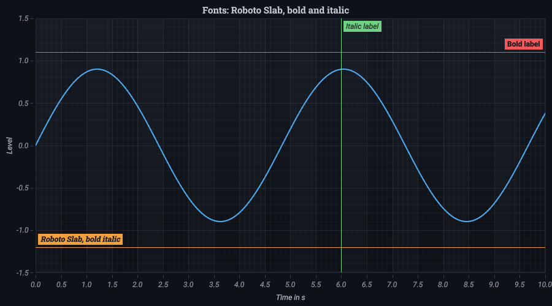

# Themes and effects

```csharp
c.Theme(BuiltInThemes.Neon);
```

Built in are `TachyonDark`, `TachyonLight`, `HighContrast`, `Neon`, `Paper`, `Instrument` and `Signal`.

To change it later, set `chart.Theme` in WPF and `chart.ChartTheme` in Avalonia, where `Theme` already belongs to the control.

Your own themes come as JSON or from XAML resources, missing values come from a base theme:

```csharp
chart.Theme = ThemeJson.Deserialize(File.ReadAllText("harbor.json"));
chart.Theme = ChartThemes.FromResources(Resources, "My theme", "dark");
```

The keys start with `Tachyon.`, for example `Tachyon.surface.background`. [Your own theme](custom-themes.md) shows
both ways step by step, where the files go and every key with its value in the base themes.

With `ThemeTransition` a change fades over.

## Colors of series

The palette of a theme colors the traces of oscilloscope, spectrum and network displays, and the series of parallel coordinates, ternary and Smith charts. This replaces colors set in code on those types. Normal series such as lines keep the colors you set.

`ChartSurface.ThemeOverride` applies a theme to every chart rendered on the current thread, for scenes that build their chart themselves.

## Glow

Lines can glow (`glow` in the theme). `ChartSurface.EffectsEnabled = false` turns it off. The glow is clear on a dark background and hardly visible on a bright one.

## Fonts

Text uses the embedded Roboto, so it looks the same everywhere. Title, axes and labels of annotations can take another
font: a family and its cut.

```csharp
c.TitleFont(new TextFont("Roboto Slab", Bold: true))
 .AxisFont(new TextFont(Italic: true));
```

In XAML the chart has `TitleFont` and `AxisFont`, written as text: `TitleFont="Roboto Slab, Bold"`, `AxisFont="Italic"`.
Annotations take `LabelFont` in their `Appearance`.

- Roboto in regular, bold, italic and bold italic and Roboto Slab in regular and bold come with the library.
- Other families come from the fonts installed, such as `Arial` or `Consolas`. A family that is not installed takes Roboto
  in the same cut, so a chart never loses its text.
- A family without an italic cut, such as Roboto Slab, leans its upright letters.

All fonts share one glyph atlas; a font used again costs nothing per frame.


